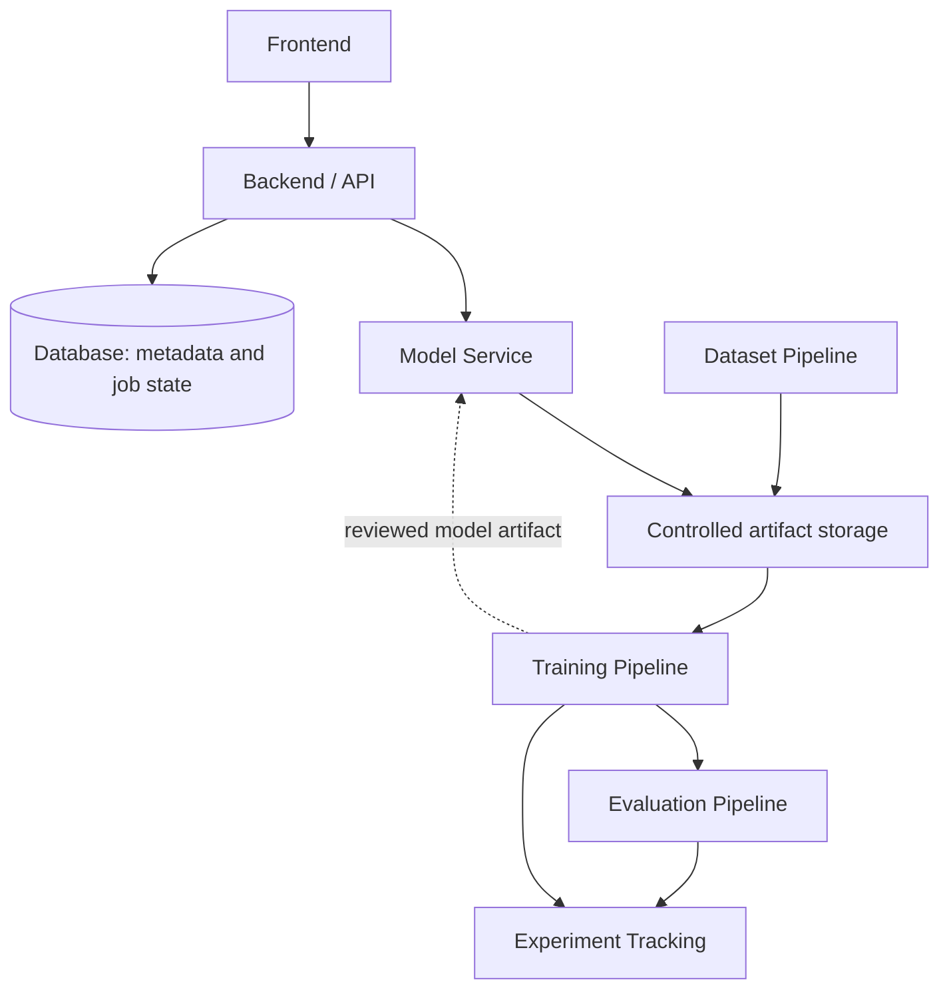

# System architecture — provisional

This document describes proposed responsibilities, not deployed services or finalized technologies.

| Component | Proposed responsibility | Decision pending |
| --- | --- | --- |
| Frontend | Upload two drawings, describe motion, inspect outputs and errors | Framework and mockups |
| Backend/API | Validate requests, manage job status and access, return artifact references | API framework, sync/async job design, authentication |
| Model service | Load an approved model and generate constrained-duration sequences | Model interface, hardware, process boundary |
| Dataset pipeline | Ingest, extract, stylize, align, annotate, quality-check, split | Tools, pairing checks, metadata schema |
| Training pipeline | Adapt selected pretrained models and record configurations | Framework, adaptation method, compute budget |
| Evaluation pipeline | Apply frozen protocols and produce comparable reports | Metrics and human evaluation rubric |
| Database | Store metadata, provenance, job state, and artifact references | Database engine and schema |
| Experiment tracking | Record configurations, versions, seeds, timing, metrics, artifact references | Local format or tracking service |

Keep videos, frames, and weights in controlled file/artifact storage; the database should hold references rather than large binary payloads. Start locally; these boundaries may initially share a process or machine. No queue, cloud vendor, database engine, frontend framework, or tracking vendor is required by this skeleton.

## Proposed request lifecycle

Submit start/end drawings and motion text → validate format, dimensions, limits, and instruction → create job metadata → run inference → validate output → expose authorized output and status. Duration/FPS controls and job contracts remain TODO. Failures should preserve actionable diagnostics without logging private images, instructions, credentials, or participant identifiers by default.

## Review requirements

Define upload limits, supported formats, timeout/cancellation behavior, GPU concurrency, artifact retention/deletion, access controls, and model provenance before deployment. Capture consent and dataset access rules apply independently of application access. See [scope](../PROJECT_SCOPE.md) and [AI pipeline](AI_PIPELINE.md).
