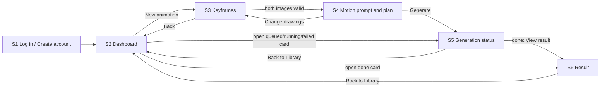

# Cue — User Flows

## Main flow

## Alternate and error paths
| From | Event | To |
|---|---|---|
| S1 | wrong credentials | stay, form alert |
| any | session expired / unauthorized | S1 (resource owned by someone else returns "Not found", NFR-01) |
| S3 | invalid file | stay, slot error |
| S4 | empty command | Generate enabled, drawings-only run |
| S4 | unsupported command | stay, reasoned alert, edit text |
| S4 | edit text after approval | approval cleared, plan out of date |
| S5 | error | message; Back to Library or New animation |
| S5 | cancel confirmed | cancelled state; Back to Library |
| S6 | New animation | S3 |
| S2 | delete confirmed | card removed, toast "Animation deleted" |
| top bar | Log out | S1 |

## Prototype flow in Figma (static)
Login → Dashboard → Upload → Motion Plan → Generation Status → Result → Dashboard. Each transition is a Figma "navigate to" on the labelled button. States (empty, error, running) are variants switched by a second set of flows (e.g. "Queued → Running → Done" via after-delay or click). The prototype does not simulate the backend; it only shows designed states in order.

## Journey notes
- The user can leave S5 at any time; the Library card keeps updating. Opening the app later lands on S2 and the job is where they left it.
- Two taps back from S6 to a new attempt: New animation → S3.
